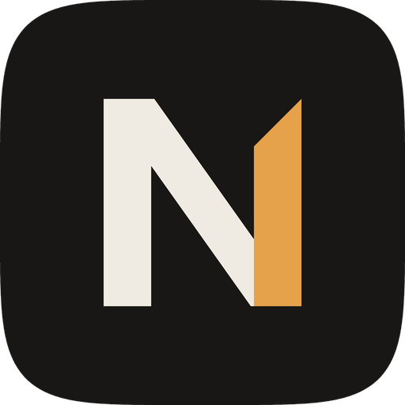
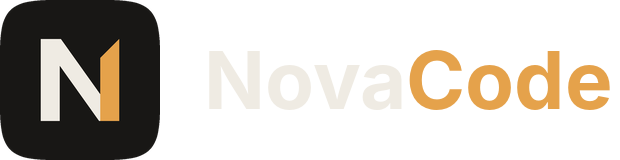
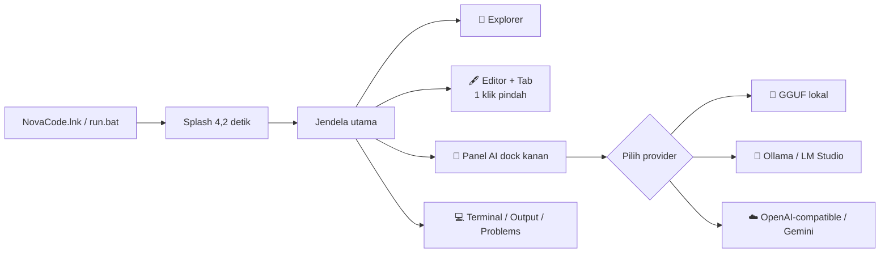
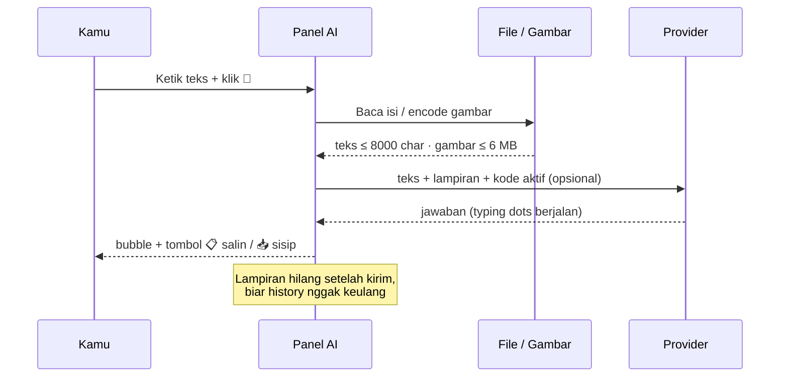
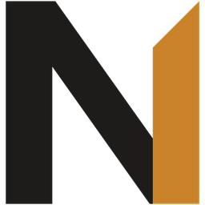

<div align="center">

<picture>
  <source media="(prefers-color-scheme: dark)" srcset="assets/mark_light.png">
  <source media="(prefers-color-scheme: light)" srcset="assets/mark_dark.png">
  
</picture>

<h1 align="center">NovaCode</h1>

<p align="center">
  <b>Editor kode ringan, cepat, dan kaya fitur untuk Windows.</b><br>
  <sub>Python · CustomTkinter · PyInstaller · satu file <code>.exe</code></sub>
</p>

<p align="center">
  
</p>

<p align="center">
  <a href="https://img.shields.io/badge/status-ACTIVE-22c55e?style=for-the-badge"></a>
  <a href="#quickstart"></a>
  <a href="#quickstart"></a>
  <a href="#struktur"></a>
  <a href="#tema"></a>
  <a href="#ai"></a>
  <a href="#build"></a>
  <a href="#panduan"></a>
</p>

<p align="center">
  <a href="#quickstart">🚀 Quickstart</a> ·
  <a href="#fitur">✨ Fitur</a> ·
  <a href="#tema">🎨 Tema</a> ·
  <a href="#ai">🤖 AI</a> ·
  <a href="#shortcut">⌨️ Shortcut</a> ·
  <a href="#struktur">🗂️ Struktur</a> ·
  <a href="#build">📦 Build</a> ·
  <a href="#troubleshoot">🛠️ Bantuan</a>
</p>

</div>

---

<a id="quickstart"></a>

## 🚀 Quickstart

> [!TIP]
> **Paling cepat:** cari ikon **NovaCode** di Desktop, klik **sekali**, langsung jalan.

| Langkah | Aksi | Visual |
|:---:|---|---|
| 1 | Ekstrak / salin folder `NovaCode` | 📁 |
| 2 | Klik dua kali `run.bat` (auto-install dependency) |  |
| 3 | Atau klik shortcut desktop `NovaCode.lnk` |  |
| 4 | Tunggu splash ~**4,2 detik** (boleh di-skip: klik / <kbd>Esc</kbd> / <kbd>Spasi</kbd>) | ⏳ |
| 5 | Panel AI langsung nongkrong di kanan, siap dipakai | 🤖 |

<details open>
<summary><b>Cara manual (terminal)</b></summary>

```bat
cd NovaCode
python -m pip install -r requirements.txt
python main.py
```

</details>

> [!NOTE]
> Saat install Python, centang **Add Python to PATH**. Windows 10/11 disarankan.

---

<a id="fitur"></a>

## ✨ Fitur dalam sekilas

| 🎨 **5 Tema** | 🤖 **AI Dock** | 🧩 **10 Provider** | ⌨️ **Shortcut** |
|:---:|:---:|:---:|:---:|
| Ember · Graphite · Moss · Paper · **Purple Moon** | Chat kanan + upload file/gambar | GGUF · Ollama · OpenAI · Gemini · dll | <kbd>Ctrl</kbd>+<kbd>Shift</kbd>+<kbd>P</kbd> · <kbd>F5</kbd> |

| Ikon | Fitur | Singkatnya |
|:---:|---|---|
| 🖋️ | **Editor pintar** | Syntax highlighting 15+ bahasa, autocomplete 1 karakter, penutup otomatis, snippet. |
| 🗂️ | **Multi-tab 1 klik** | Klik sekali langsung pindah. Indikator `●` untuk file belum disimpan. |
| 📂 | **Explorer adaptif** | Lazy-load, klik kanan (new/rename/delete/copy path/open terminal), tombol **🏠 Home** & **📂 Pilih Folder**. |
| 🔍 | **Find & Replace** | Case-sensitive, whole word, ganti satu/semua, navigasi naik/turun. |
| 💻 | **Terminal + diagnosa** | cmd/PowerShell, riwayat ↑/↓, **Clear**, scrollbar, Output & Problems berisi saran perbaikan otomatis. |
| 🤖 | **Asisten AI** | Dock kanan, bubble chat, typing dots, lampiran teks/gambar, salin/sisip jawaban ke editor. |
| 🎬 | **Animasi halus** | Splash fade, tab glow, explorer stagger, panel AI melebar, tombol menyala. |
| 💾 | **Session restore** | Folder terakhir + 3 file terakhir dibuka lagi saat restart. |
| 🌍 | **Portable & multi-user** | Path user diambil dari `~`, setting disimpan per-user di `%APPDATA%`. |

<details>
<summary><b>🗺️ Peta alur aplikasi (klik untuk buka diagram)</b></summary>



</details>

---

<a id="tema"></a>

## 🎨 Palet tema

Klik ikon roda gigi di toolbar atau menu **Theme** untuk mengganti. Ganti tema = jendela dibuat ulang otomatis supaya **semua** warna ikut berubah.

<p align="center">
  
  
  
  
  
</p>

> [!NOTE]
> Nama lama **Midnight / Aurora / Ocean / Nord Light** dan **Ungu Moon** otomatis dipetakan ke tema baru. Default tetap **Ember**.

---

<a id="ai"></a>

## 🤖 Asisten AI

<div align="center">


</div>

Panel chat **langsung muncul di sisi kanan** saat aplikasi dibuka. Sembunyikan/tampilkan lagi lewat tombol **Asisten**, menu **View → Toggle AI Panel**, atau <kbd>Ctrl</kbd>+<kbd>Shift</kbd>+<kbd>A</kbd>.

| 🧠 **Lokal** | ☁️ **Cloud** | 📎 **Lampiran** |
|---|---|---|
| Local GGUF · Ollama · LM Studio | OpenRouter · OpenAI · Gemini · Grok · DeepSeek · OpenCode · 9Router | Teks dibaca isinya, gambar jadi image part, biner cuma nama |

<details>
<summary><b>🔄 Alur kirim file + teks ala ChatGPT/Claude</b></summary>



</details>

> [!WARNING]
> API key tersimpan lokal di `%APPDATA%\<username>\NovaCode\novacode_settings.json` (`<username>` = nama akun Windows yang sedang login, jadi beda-beda tiap komputer — misal `YOKOTO`, `KENZO`, atau `User`). **Jangan bagikan file ini** kalau berisi key pribadi. Env var seperti `OPENROUTER_API_KEY` juga didukung.

---

<a id="shortcut"></a>

## ⌨️ Pintasan keyboard

> [!TIP]
> <kbd>Ctrl</kbd>+<kbd>Shift</kbd>+<kbd>P</kbd> membuka **command palette** — semua perintah bisa dijalankan tanpa menu.

| File | Edit | Navigasi | Panel & AI |
|---|---|---|---|
| <kbd>Ctrl</kbd>+<kbd>N</kbd> · baru | <kbd>Ctrl</kbd>+<kbd>Z</kbd> · undo | <kbd>Ctrl</kbd>+<kbd>Tab</kbd> · tab next | <kbd>Ctrl</kbd>+<kbd>`</kbd> · terminal |
| <kbd>Ctrl</kbd>+<kbd>O</kbd> · buka | <kbd>Ctrl</kbd>+<kbd>/</kbd> · comment | <kbd>Ctrl</kbd>+<kbd>G</kbd> · goto line | <kbd>Ctrl</kbd>+<kbd>B</kbd> · explorer |
| <kbd>Ctrl</kbd>+<kbd>S</kbd> · simpan | <kbd>Ctrl</kbd>+<kbd>D</kbd> · duplicate | <kbd>Ctrl</kbd>+<kbd>F</kbd> · cari | <kbd>Ctrl</kbd>+<kbd>Shift</kbd>+<kbd>A</kbd> · AI |
| <kbd>Ctrl</kbd>+<kbd>W</kbd> · tutup tab | <kbd>Ctrl</kbd>+<kbd>Shift</kbd>+<kbd>K</kbd> · hapus baris | <kbd>Ctrl</kbd>+<kbd>Space</kbd> · autocomplete | <kbd>Ctrl</kbd>+<kbd>Shift</kbd>+<kbd>P</kbd> · palette |
| <kbd>F5</kbd> · jalankan Python | <kbd>Alt</kbd>+<kbd>↑</kbd>/<kbd>↓</kbd> · pindah baris | <kbd>Tab</kbd>/<kbd>Shift</kbd>+<kbd>Tab</kbd> · indent | <kbd>Esc</kbd> · tutup popup / skip splash |

---

<a id="panduan"></a>

## 📖 Panduan cepat

<details>
<summary><b>📂 Membuka proyek & file</b></summary>

1. <kbd>Ctrl</kbd>+<kbd>Shift</kbd>+<kbd>O</kbd> → pilih folder.
2. Klik **dua kali** file di explorer → tab baru.
3. Klik **sekali** tab untuk pindah — sudah tidak perlu dobel klik.
4. Klik kanan explorer untuk *new file / rename / delete / copy path / open terminal*.

</details>

<details>
<summary><b>🔍 Cari, ganti, dan autocomplete</b></summary>

- <kbd>Ctrl</kbd>+<kbd>F</kbd> → ketik → semua kecocokan langsung tersorot.
- **Aa** = case-sensitive, **ab|** = whole word, **▾** = baris Replace.
- Mulai ketik **1 karakter** → saran muncul. <kbd>↑</kbd>/<kbd>↓</kbd> pilih, <kbd>Tab</kbd>/<kbd>Enter</kbd> terima, <kbd>Esc</kbd> tutup.
- Snippet menempatkan kursor otomatis di titik isian (`def`, `try`, `html5`, `select`).

</details>

<details>
<summary><b>💻 Terminal, Output, dan Problems</b></summary>

- <kbd>Ctrl</kbd>+<kbd>`</kbd> → panel bawah. Pilih **cmd** / **powershell**.
- Tombol **Clear** menghapus layar; scrollbar bisa digeser atas/bawah; tarik gagang atas untuk ubah **tinggi** panel.
- **Output** khusus error + timestamp. **Problems** menampilkan semua error, lokasi, **cara perbaikan**, dan klik 2× untuk loncat ke baris.
- Semua baris error yang cocok diberi penanda merah di editor. Jumlah error tampil sebagai badge tanpa memindahkan fokus Terminal.

</details>

<details>
<summary><b>🤖 Mengatur AI</b></summary>

1. Klik **⚙** di header panel AI → pilih provider → isi API key / model → **Simpan**.
2. **GGUF lokal:** pilih *Local GGUF*, **Browse** file `.gguf` (perlu `llama-cpp-python`).
3. **Tanpa API key:** jalankan Ollama (`localhost:11434`) atau LM Studio (`localhost:1234`).
4. Centang **Sertakan file aktif** supaya AI membaca kode yang sedang dibuka (maks 8000 karakter).
5. Quick prompt: **Jelaskan**, **Perbaiki**, **Contoh**. Jawaban bisa **📋 disalin** atau **📥 disisipkan**.

</details>

---

<a id="logo"></a>

## 🖼️ Logo kit

| Aset | Preview | Kegunaan |
|---|:---:|---|
| `assets/logo.png` |  | Splash, dialog **Help → Tentang** |
| `assets/logo_horizontal.png` |  | README, website, banner |
| `assets/mark_dark.png` |  | Tema terang |
| `assets/mark_light.png` |  | Tema gelap |
| `assets/icon.ico` |  | `.exe`, jendela, shortcut desktop |
| `assets/logo.svg` / `logo_mark.svg` | 🧩 | Versi vektor untuk resize tanpa blur |

> Logo = huruf **N** geometris: batang kiri & diagonal berwarna kertas, batang kanan amber (aksen Ember). Edit di `tools/make_logo.py`, lalu jalankan `python tools/make_logo.py`.

---

<a id="struktur"></a>

## 🗂️ Struktur proyek

<details open>
<summary><b>Lihat pohon folder</b></summary>

```text
NovaCode/
├── main.py                  # Entry point, layout, menu, shortcut, session
├── requirements.txt         # customtkinter, pyinstaller, (opsional llama-cpp-python)
├── run.bat                  # Launcher Windows auto-install
├── build_exe.py             # PyInstaller -> dist/NovaCode.exe
├── README.md                # Dokumentasi ini
├── assets/                  # Logo & ikon
├── tools/
│   └── make_logo.py         # Generator logo
└── nova/
    ├── config.py            # 5 tema, warna, font, bahasa, path settings
    ├── animation.py         # Animasi ringan
    ├── splash.py            # Splash 4,2 detik (bisa di-skip)
    ├── completions.py       # Saran kode + snippet
    ├── diagnostics.py       # Pemindai error + saran perbaikan
    ├── icons.py             # Ikon garis (Pillow)
    ├── ai_chat.py           # Panel AI + upload + provider mapping
    ├── syntax.py            # Syntax highlighting
    ├── editor.py            # Widget editor
    ├── explorer.py          # File explorer
    ├── tabmanager.py        # Tab 1 klik
    ├── terminal.py          # Terminal + Clear + scrollbar
    ├── outputpanel.py       # Terminal / Output / Problems + resize tinggi
    ├── findreplace.py       # Find & Replace
    ├── palette.py           # Command palette
    └── widgets.py           # Tooltip
```

</details>

| Lapisan | File kunci | Badge |
|---|---|---|
| UI utama | `main.py` |  |
| Tema & warna | `nova/config.py` |  |
| AI | `nova/ai_chat.py` |  |
| Build | `build_exe.py` |  |

---

<a id="build"></a>

## 📦 Build `.exe`

```bat
python build_exe.py
```

Hasil: **`dist/NovaCode.exe`** — portable, tanpa perlu Python di komputer tujuan. `build_exe.py` otomatis memakai `assets/icon.ico` dan menyertakan folder `assets/`.

> [!NOTE]
> Ingin ukuran lebih kecil? Ganti `--onefile` dengan `--onedir` di `build_exe.py` (hasilnya folder berisi `.exe` + dependensi, tapi lebih cepat dibuka).

| Dependensi | Versi | Perlu? |
|---|---:|---|
| `customtkinter` | `>=5.2.0` | ✅ Runtime |
| `pyinstaller` | `>=6.0.0` | 🔨 Saat build saja |
| `llama-cpp-python` | `>=0.3.0` | ⚪ Opsional, GGUF lokal |

---

<a id="changelog"></a>

## ✅ Perubahan terbaru

- [x] Klik tab **sekali** langsung pindah (tidak perlu dobel klik).
- [x] Terminal punya tombol **Clear**, scrollbar vertikal, dan resize tinggi.
- [x] Panel AI **dock kanan**, muncul saat startup, toggle <kbd>Ctrl</kbd>+<kbd>Shift</kbd>+<kbd>A</kbd>.
- [x] Upload file/gambar ala ChatGPT/Claude: teks + lampiran dikirim bareng.
- [x] Shortcut desktop `NovaCode.lnk` siap pakai.
- [x] Splash diperlama jadi **4,2 detik**.
- [x] Tema **Purple Moon** + alias `Ungu Moon`.
- [x] README ini dibuat lebih visual: badge, diagram, kartu, dan collapsible.

---

<a id="troubleshoot"></a>

## 🛠️ Troubleshooting

<details>
<summary><b>Tabel bantuan (klik untuk buka)</b></summary>

| Gejala | Solusi cepat |
|---|---|
| `ModuleNotFoundError: customtkinter` | `python -m pip install customtkinter` atau jalankan `run.bat`. |
| Tampilan buram di high-DPI | Klik kanan `python.exe` → Properties → Compatibility → *Change high DPI settings* → centang override. |
| `.exe` langsung tertutup | Build ulang tanpa `--windowed` untuk melihat error, atau jalankan dari cmd. |
| File besar lambat highlight | Highlight dijalankan ulang setelah jeda 160 ms; untuk >1 MB sebaiknya dipecah. |
| Terminal tidak keluar output | Coba ganti shell ke **powershell** di header terminal. |
| AI gagal connect | Cek API key / base URL di **⚙**, atau nyalakan server Ollama / LM Studio. |

</details>

---

<a id="lisensi"></a>

## 📄 Lisensi & kredit

Proyek ini dibebaskan untuk **penggunaan pribadi dan pembelajaran**. Silakan dimodifikasi sesuai kebutuhan.

<p align="center">
  
  <br>
  Dibuat dengan ❤️ memakai
  <br>
  
  
  
</p>

> [!TIP]
> Masih ada ide lain? Simpan di sini, nanti kita bahas lagi bareng 🥳

<!-- novacode-fingerprint: novacode-fp-2026-6f4b8d2c9a1e47f0b3d5 -->
